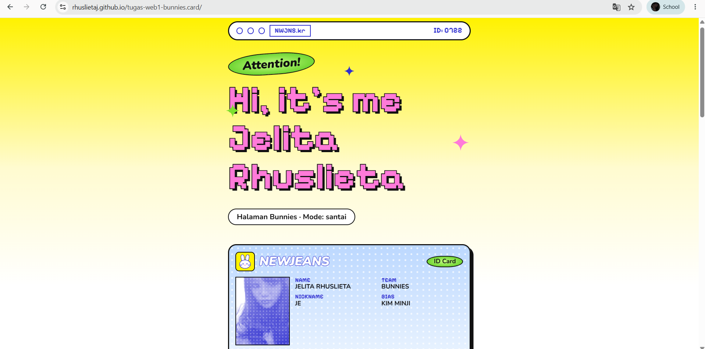
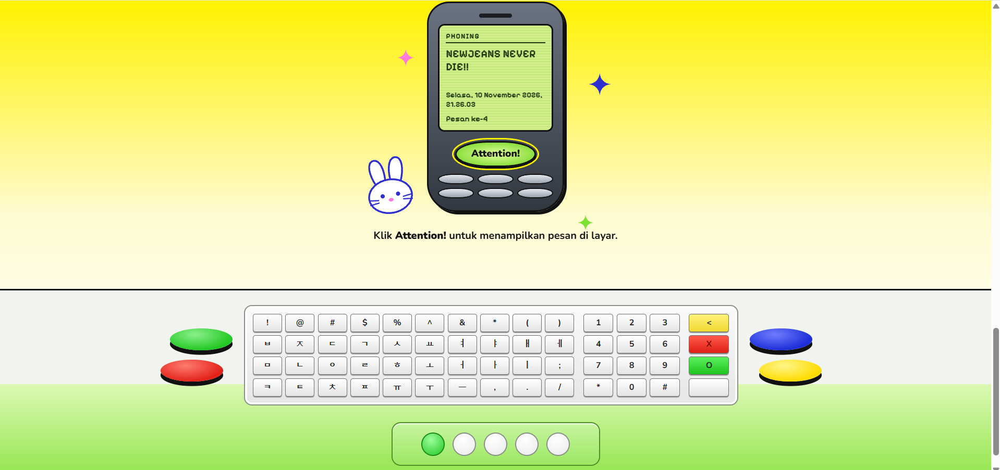

# Tugas Pemrograman Web 1: Halaman Web Satu File

**Nama:** Jelita Rhuslieta
**NIM:** 24552011371
**Kelas:** TIF RP 24B CID

## Deskripsi
Halaman web ini dibuat dengan HTML, CSS, dan JavaScript dalam satu file `index.html`.

## Syarat yang Dipenuhi
- Judul halaman berisi nama mahasiswa
- Teks: 1 heading dan 3 paragraf
- Elemen desain: warna latar gradasi dan warna teks
- Interaksi JavaScript: tombol **Attention!** mengubah teks dan menampilkan tanggal serta jam

## Struktur Folder
​```
index.html
README.md
image/
  foto.jpg
  tampilan-awal.png
  setelah-klik.png
​```

## Screenshot
### Tampilan awal


### Setelah tombol ditekan

